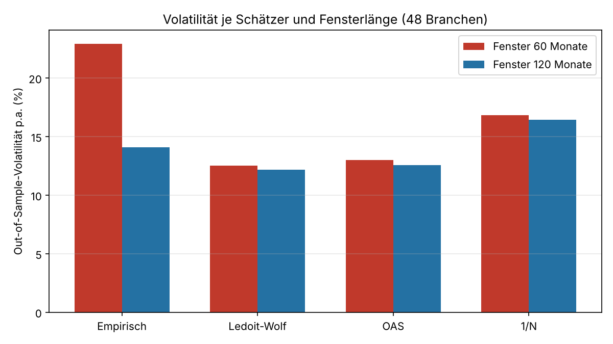

# Portfoliooptimierung auf Basis von Machine-Learning-Methoden

**Verbesserung der Kovarianzschätzung durch Shrinkage-Methoden**

Bachelorarbeit im Studiengang Wirtschaftsmathematik, HTW Berlin
Jean Jacques Kamdem · eingereicht am 13. Oktober 2026

Gutachter: Prof. Dr. Manfred-Erich Jäger-Ambrozewicz, Prof. Dr. Sunna Torge

Dieses Repository ist das Replikationspaket des empirischen Teils: Daten, ein Hilfsskript und je ein eigenständiges, offline lauffähiges Skript für jede Tabelle und Abbildung der Arbeit.

## Forschungsfrage

> Führen Shrinkage-Schätzer der Kovarianzmatrix zu robusteren Out-of-Sample-Portfolios als der klassische empirische Schätzer?

Untersucht wird das Global-Minimum-Varianz-Portfolio (GMV), das nur von der Kovarianzmatrix abhängt. Verglichen werden der empirische Schätzer, Ledoit-Wolf, Oracle Approximating Shrinkage (OAS) und die naive Gleichgewichtung 1/n in einem Rolling-Window-Backtest auf monatlichen Industrieportfolios der Kenneth French Data Library (1969–2026).

## Zentrale Ergebnisse

Out-of-Sample, 48 Branchen:

| Methode | Vola p.a. (τ = 60) | Sharpe (τ = 60) | Turnover (τ = 60) | Vola p.a. (τ = 120) | Sharpe (τ = 120) |
| --- | --- | --- | --- | --- | --- |
| Empirisch | 22,94 % | 0,290 | 1,907 | 14,09 % | 0,729 |
| Ledoit-Wolf | 12,52 % | 0,795 | 0,246 | 12,18 % | 0,912 |
| OAS | 12,99 % | 0,747 | 0,301 | 12,58 % | 0,849 |
| 1/n | 16,84 % | 0,802 | 0,000 | 16,43 % | 0,807 |

- Ledoit-Wolf senkt die Volatilität bei τ = 60 um rund 45 % und die mittlere Konditionszahl von über 18 000 auf 258.
- Der Vorteil wächst mit n/T: Volatilitätsreduktion 1,9 % (n = 10), 6,1 % (n = 30), 13,5 % (n = 48) bei τ = 120.
- Bei der Sharpe-Ratio bleibt 1/n konkurrenzfähig, im Einklang mit DeMiguel, Garlappi und Uppal (2009).



## Inhalt

| Datei | Inhalt |
| --- | --- |
| `10_/30_/48_Industry_Portfolios.csv` | Kenneth French Data Library, monatliche wertgewichtete Renditen |
| `daten_vorbereiten.py` | Hilfsskript: lädt und bereinigt eine French-CSV (`lade_renditen`) |
| `Repli_Tabelle1_Schaetzproblem.py` | Konditionszahl und Rang der empirischen Kovarianzmatrix je Fensterlänge |
| `Repli_Tabelle2_Kennzahlen.py` | Out-of-Sample-Kennzahlen (Vola, Sharpe, Turnover, Konditionszahl) für τ = 60 und 120 |
| `Repli_Tabelle3_Dimension.py` | Volatilitätsreduktion nach Dimension (n = 10, 30, 48) |
| `Repli_Abbildung1_Effizienzlinie.py` | Effizienzlinie, GMV- und Tangentialportfolio (hypothetisches Beispiel) |
| `Repli_Abbildung2_Rolling.py` | Schema des Rolling-Window-Verfahrens |
| `Repli_Abbildung3_Problem.py` | Konditionszahl in Abhängigkeit von n/T |
| `Repli_Abbildung4_Volatilitaet.py` | Out-of-Sample-Volatilität je Schätzer und Fensterlänge |
| `Repli_Abbildung5_Dimension.py` | Volatilitätsreduktion nach Anzahl der Branchen |
| `abbildung*.png` | Von den Skripten erzeugte Abbildungen |

## Ausführung

```bash
pip install -r requirements.txt
python3 Repli_Tabelle1_Schaetzproblem.py
python3 Repli_Tabelle2_Kennzahlen.py
python3 Repli_Tabelle3_Dimension.py
python3 Repli_Abbildung1_Effizienzlinie.py   # usw. für Abbildung 2 bis 5
```

Die Skripte im Hauptverzeichnis ausführen, da sie die CSV-Dateien und `daten_vorbereiten.py` relativ laden.

## Ausblick

Nichtlineares Shrinkage (Ledoit und Wolf, 2017), Ausweitung auf Einzelaktien, formaler Test der Sharpe-Differenzen (Ledoit und Wolf, 2008) sowie faktorbasierte und Graphical-Lasso-Schätzer.

## Literatur (Auswahl)

- Markowitz, H. (1952). Portfolio Selection. *Journal of Finance*.
- Ledoit, O. und Wolf, M. (2004). A well-conditioned estimator for large-dimensional covariance matrices. *Journal of Multivariate Analysis*.
- Chen, Y., Wiesel, A. und Hero, A. O. (2010). Shrinkage Algorithms for MMSE Covariance Estimation. *IEEE Transactions on Signal Processing*.
- DeMiguel, V., Garlappi, L. und Uppal, R. (2009). Optimal Versus Naive Diversification. *Review of Financial Studies*.
- Hastie, T., Tibshirani, R. und Friedman, J. (2009). *The Elements of Statistical Learning*.

Datenquelle: [Kenneth R. French Data Library](https://mba.tuck.dartmouth.edu/pages/faculty/ken.french/data_library.html).
